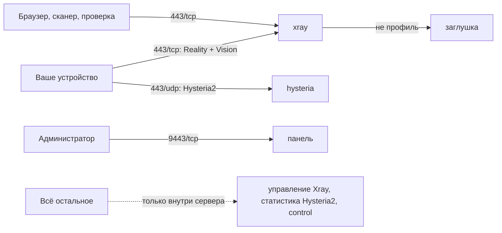

<p align="center">
  <picture>
    <source media="(prefers-color-scheme: dark)" srcset="docs/images/ezopenpn-logo-dark.webp">
    
  </picture>
</p>

<p align="center">
  <b>Личный сервер защищённых подключений: одна команда, русская панель, домен не нужен.</b>
</p>

<p align="center">
  <a href="https://github.com/A1exZabr/EzOpenPN/releases/latest"></a>
  <a href="https://github.com/A1exZabr/EzOpenPN/actions/workflows/ci.yml"></a>
  
  <a href="LICENSE"></a>
</p>

<p align="center">
  <a href="#установка-одной-командой">Установка</a> ·
  <a href="docs/getting-started.md">Инструкция с нуля</a> ·
  <a href="docs/security.md">Безопасность</a> ·
  <a href="docs/releases/v1.0.0.md">Что нового</a>
</p>

> [!IMPORTANT]
> Для первой установки используйте отдельный чистый VPS без сайтов, панелей хостинга и других сервисов. Это самый простой и предсказуемый вариант для новичка.

EzOpenPN разворачивает личный сервер защищённых подключений с русской веб-панелью. У каждого профиля сразу есть два независимых транспорта: VLESS + Reality с Vision и Hysteria2 с Salamander. Если один маршрут работает нестабильно, в приложении можно выбрать второй. Снаружи сервер выглядит как обычный сайт на своём IP-адресе: домен не нужен.

> [!NOTE]
> **v1.0.0: стабильный выпуск без полной проверки.** Транспорт A переведён на Vision и Selfsteal: проверки и сканеры видят собственную заглушку сервера с настоящим сертификатом его IP. По сообщению владельца, тестеры, проверявшие сборку, подтвердили её стабильность. Замеров и таблицы проверенных приложений нет, работу у каждого оператора не обещаем. [Что изменилось и что не проверено](docs/releases/v1.0.0.md).

Впервые видите терминал? Начните с [инструкции с нуля](docs/getting-started.md): выбор сервера, вход, установка и первое подключение. Домашний компьютер не нужно держать включённым. Домен покупать не нужно. Аренду сервера вы оплачиваете своему провайдеру, EzOpenPN не принимает платежи.

## Что вы получаете

| | |
|---|---|
| **Два независимых транспорта** | VLESS + Reality с Vision и Hysteria2 с Salamander у каждого профиля. Если один маршрут нестабилен, в приложении выбирается второй. |
| **Сервер, который выглядит как сайт** | На `443` обычная страница-заглушка с настоящим сертификатом на IP сервера, на `80` постоянный `301`. Свои профили проходят дальше. |
| **Без домена** | Нужен только публичный IPv4. Сертификат Let's Encrypt выпускается и продлевается на сам IP. |
| **Русская панель** | Отдельный профиль на каждое устройство, QR-код, общая ссылка-подписка и отключение профиля в один клик. |
| **Всё автоматически** | Docker, сервисы, сертификат, firewall, резервные копии и обновление ставятся и запускаются командами установщика. |
| **Проверяемый выпуск** | Подписанные пакеты и теги, SBOM, образы закреплены по digest и скачиваются без входа. |

## Как это устроено



Подробности в [архитектуре](docs/architecture.md).

### Как сервер выглядит снаружи

Обычный посетитель, сканер или проверка провайдера, открыв `https://SERVER_IP/`, видит простую страницу-заглушку. У каждого сервера она своя и не содержит названия EzOpenPN. Её отдаёт сам сервер с сертификатом Let's Encrypt на его IP, поэтому адрес, сертификат и страница согласованы между собой.

- `443/tcp`: Reality принимает только свои профили, всё остальное отдаёт заглушке. Она отвечает по TLS 1.2 и TLS 1.3 с HSTS.
- `80/tcp`: постоянное перенаправление `301` на `https://SERVER_IP/`.
- Транспорт A использует Vision, поэтому вложенный TLS не виден. Trojan и VLESS без Vision не используются.
- Управление Xray, статистика Hysteria2 и внутренний сервис панели доступны только внутри сервера. Наружу открыты только `80/tcp`, `443/tcp`, `443/udp` и `9443/tcp` (сама панель).

Команда `sudo ezopenpn doctor` проверяет всё это на живом сервере: строки `camouflage`, `http_redirect` и `published_ports`. Это снижает заметность, но не гарантирует работу при любых блокировках.

## Что понадобится

- VPS с напрямую назначенным публичным IPv4, архитектурой amd64, минимум 512 МиБ RAM, видимой операционной системе, и 4 ГиБ свободного места. Рекомендуется тариф от 1 ГиБ RAM; swap не обязателен.
- Чистая Ubuntu 22.04 LTS, Ubuntu 24.04 LTS, Debian 12 или Debian 13.
- Доступ к серверу по SSH с root или рабочим `sudo`.
- Входящие правила `80/tcp`, `443/tcp`, `443/udp` и `9443/tcp` в firewall провайдера. Порт SSH EzOpenPN не меняет.

Подробный выбор и подготовка сервера описаны в [пошаговой инструкции](docs/getting-started.md).

## Установка одной командой

Пакеты выпуска лежат в GitHub Releases, контейнеры в публичном GHCR. Уже работающий сервер переустанавливать не нужно: порядок обновления описан ниже.

На **новом сервере**, после входа по SSH как `root`, вставьте всю строку и нажмите Enter. Если вошли другим пользователем, сначала выполните `sudo -i`.

```bash
curl -fsSL https://github.com/A1exZabr/EzOpenPN/releases/download/v1.0.0/install.sh | env EZOPENPN_EXPECTED_VERSION=v1.0.0 EZOPENPN_RELEASE_BASE_URL=https://github.com/A1exZabr/EzOpenPN/releases/download/v1.0.0 bash
```

Это одна команда, даже если браузер показывает её в несколько строк. Она закреплена за v1.0.0 и проверяет подпись пакета. Эта же версия доступна по короткому адресу `releases/latest`, он нужен для обновления существующих серверов. Если отсутствуют `curl` или `python3`, см. [подготовку](docs/getting-started.md#4-установите-ezopenpn).

Установщик проверит систему, подготовит Docker и сервисы, затем попросит придумать логин и пароль администратора. Пароль вводится скрыто и должен содержать не менее 12 символов. Сохраните его в менеджере паролей.

В конце появится примерно такой результат:

```text
EzOpenPN готов.
Панель: https://SERVER_IP:9443
Проверка: sudo ezopenpn status
Сброс пароля: sudo ezopenpn admin reset-password
```

Откройте выданный адрес, войдите с созданными данными и добавьте первый профиль.

## Первый профиль

1. Создайте профиль с понятным именем устройства.
2. Выберите приложение по [инструкции и ограничениям совместимости](docs/compatibility.md).
3. Отсканируйте QR-код или вставьте общую ссылку.
4. Переключите транспорт, если первый вариант нестабилен.

Один профиль рекомендуется использовать на одном устройстве. Подробности есть в [инструкции по профилям](docs/profiles.md).

## Если доступ к панели потерян

Подключитесь к серверу по SSH и выполните:

```bash
sudo ezopenpn admin reset-password
```

Команда меняет только пароль администратора, завершает прежние сеансы панели и сохраняет все профили.

## Защитите сервер

Публичные адреса автоматически проверяют боты: они ищут открытые службы, известные уязвимости и слабые пароли. Это происходит и с новым сервером. EzOpenPN не меняет настройки SSH за вас.

Пройдите [инструкцию по SSH-ключам](docs/ssh-security.md): создайте ключ на своём компьютере, проверьте вход в отдельном окне и только после этого отключите вход по паролю. Пароль панели и ключ сервера являются разными способами доступа. Не публикуйте ссылки профилей и QR-коды.

## Если подключение перестало работать

Сначала переключите транспорт и сравните домашнюю и мобильную сеть. Если заблокирован именно IP, может помочь новый сервер с другим адресом. Это не универсальное средство от любых блокировок. [Проверки и безопасный переезд](docs/server-migration.md) объясняют, когда менять сервер, как перенести устройства и когда отменять старую аренду.

## Обслуживание

```bash
sudo ezopenpn status
sudo ezopenpn doctor
sudo ezopenpn update
sudo ezopenpn backup
```

Полный набор безопасных команд и сценарии восстановления находятся в [руководстве по восстановлению](docs/recovery.md). Если установка остановилась с кодом `E_...`, откройте [справочник ошибок](docs/troubleshooting.md).

## Документация

| Раздел | О чём |
|---|---|
| [Начало работы](docs/getting-started.md) | Выбор сервера, вход, установка, первое подключение |
| [Профили и импорт](docs/profiles.md) | Профили устройств, QR-код, общая ссылка |
| [Совместимость](docs/compatibility.md) | Клиентские приложения и ограничения |
| [Безопасность](docs/security.md) | Границы доверия, порты, секреты |
| [SSH-ключи](docs/ssh-security.md) | Вход по ключу и отключение паролей |
| [Восстановление](docs/recovery.md) | Обновление, резервные копии, сброс пароля |
| [Диагностика](docs/troubleshooting.md) | Справочник кодов `E_...` |
| [Блокировки и новый сервер](docs/server-migration.md) | Когда менять сервер и как перенести устройства |
| [Архитектура](docs/architecture.md) | Сервисы, сети, жизненный цикл профиля |
| [Проверка выпуска](docs/releases/release-checklist.md) | Испытания во внешних сетях |
| [Что нового в v1.0.0](docs/releases/v1.0.0.md) | Состав и ограничения текущего выпуска |
| Прежние выпуски | [v0.2.3](docs/releases/v0.2.3.md), [v0.2.1](docs/releases/v0.2.1.md) |

## Обновления и обратная связь

Стабильное обновление запускается командой `sudo ezopenpn update`. Образы скачиваются без остановки сервиса. Затем стек ненадолго останавливается для проверенной резервной копии и переключения версии; неудачный запуск автоматически возвращает прежнее состояние.

На уже настроенном сервере повторный запуск установщика использует стабильный канал обновлений, а не выбирает предварительный выпуск. Сервер на v0.1.9 перейдёт на v1.0.0: запустите `sudo ezopenpn update` или короткую команду установки из GitHub, она найдёт существующую установку и выполнит обновление с резервной копией. Ключи, профили и пароль панели сохраняются. После обновления у профилей меняется ссылка транспорта A: приложения с подпиской получат её сами, а вставленную вручную ссылку A нужно импортировать заново. Ошибка предварительной проверки или скачивания не останавливает существующую установку.

О проблемах без секретных данных можно сообщать через [GitHub Issues](https://github.com/A1exZabr/EzOpenPN/issues). Уязвимости нельзя публиковать в открытом issue: используйте закрытый канал из файла [SECURITY.md](SECURITY.md).
